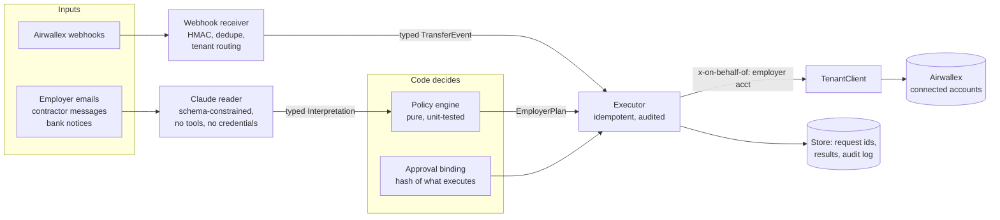

# Payday Guardian

**An AI payroll agent for contractor platforms on Airwallex.** It pays each employer's contractors from that employer's own wallet, prices fees in before it converts currency, and routes each payout to land before its local cut-off. It holds a payout when an email asks to redirect someone's pay, re-pays a bank return exactly once, and escalates to a person only the cases code cannot decide.

Airwallex Agentic Banking Hackathon · Starter Kit 06, Multi-Employer Payroll Executor · team VALOR

> **Demo video (4 minutes):** https://youtu.be/GVIRaVwaD6A — recorded from the live sandbox run

> **Proof it ran live:** the full demo on three Kit 6 connected accounts in the Airwallex sandbox, with Claude reading the messages. 35 of 36 contractors were paid on payday. The [audit log](docs/evidence/) has 297 API calls: 0 errors, and no employer call outside the three employer accounts.

## Try it in 60 seconds (no credentials needed)

Requires Node 24 or later.

```bash
npm ci
npm run demo      # the full payday story on a deterministic offline bank
npm run console   # http://localhost:4321
```

The console steps through the payday timeline and shows each employer's wallet and all 36 payouts, coloured by status. **Live sandbox** in its header switches to the committed live run, so you can inspect it without an Airwallex account.

`npm test` runs the test suite (typecheck with `npm run typecheck`).

## The problem

Contractor and EOR platforms pay many people in many countries for many employers. Every payday the ops team makes the same high-stakes calls under time pressure:

- **Whose money?** Funding arrives late or partially. Summing balances across tenants says "enough money" for a batch the short employer cannot fund, and paying Employer B's people with Employer C's money is a compliance breach.
- **Which rail, and in time?** Each country has its own rail, fee and cut-off. If SWIFT fees aren't priced in before converting, the last payout fails. If a cut-off is missed, wages arrive late.
- **Is this request real?** "My account changed, pay me at this new one today, it's urgent" is how payroll diversion fraud starts.
- **Did it land?** Banks return payouts. A careless retry pays twice.

## What the agent does on payday

The demo follows the builder guide's arc: goal, plan, new information, revised decision, result. Every number comes from policy code and the bank. Claude reads the messages and explains the exceptions.

| Time (UTC) | New information | What Payday Guardian decides |
|---|---|---|
| 04:00 | Payday for 3 employers × 12 contractors in the US, UK, Germany, Mexico, the Philippines and India | Plans each employer separately. Each plan includes fees, nets FX against what the wallet already holds, picks a LOCAL or SWIFT rail per contractor from the cut-offs, and lists exactly what to request from a short employer |
| 04:10 | **#1** Fabrikam's deposit lands while Contoso is still short | A pooled ledger would now see USD 103,000 and pay Contoso in full, partly with other employers' money. The agent pays Fabrikam in full and keeps Contoso within its own wallet: statutory and cheapest-to-fund payouts first, the rest held, the platform fee deferred |
| 04:20 | **#2** "Please send my pay to this new account today, urgent" | Claude flags the red flags. Code holds only Maria's payout, never uses the account number in the email, and the rest of the payroll runs. Claude writes the ops lead a plain-language note: why the agent stopped and what would release it |
| 04:50 | A person calls Maria on the number on file: Maria never sent the email | The agent requests an approval bound to a SHA-256 of exactly what will execute (amount, currency, the account on file, employer account, evidence). The same approval is rejected for the email's account and for a larger amount. Maria is paid to the account on file; the fraudster gets nothing |
| 05:30 | **#3** A bank return on Valeria's MXN payout (an email notice, plus a signed `payout.transfer.failed` webhook offline) | Verifies the webhook's signature and ignores its redelivery. Confirms the return from the API, not the email. Re-validates the beneficiary and re-pays once; running the repay again returns the same transfer |
| 06:40 | **#4** Contoso's top-up lands after the Philippine cut-offs | Checks the wallet rather than the email, pays everyone whose payout can still land today, and escalates to a person the Philippine payouts whose cut-off has passed |
| 07:00 | Result | Payday report, final balances per employer, audit log |

| | Offline rehearsal (`npm run demo`) | Live sandbox (`npm run demo:live`) |
|---|---|---|
| Paid on payday | 34 / 36 | **35 / 36** |
| Diversions stopped / released to the account on file after approval | 1 / 1 | 1 / 1 |
| Escalated after the cut-off | 2 | 1 |
| Bank returns re-paid once | 1 | 1 |
| Platform fees charged / deferred | 3 / 1 | 3 / 1 |

| Airwallex API calls / errors | 199 / 0 (in-memory) | **297 / 0** on the sandbox ([evidence](docs/evidence/)) |

The live run paid one more person because live FX rates differ from the offline bank's fixed rates. At 04:10, Contoso's own money stretched to one more Philippine payout before the cut-off. The policy is the same in both runs; only the rates differ.

## Design: the model reads, the code decides, the API moves the money



- **Claude explains** (`src/agent/explainer.ts`). For each exception a person must handle (a fraud hold, a missed cut-off), code assembles the facts, reasons and allowed options, and Claude writes the note the ops lead reads. Any number in the note that is not in the facts makes the agent discard it for a template, so the model cannot introduce an amount or an account.
- **Claude reads** (`src/agent/claude-interpreter.ts`). Claude Opus 5.5 turns each inbound message into a schema-validated reading: kind, person, amount, currency, red flags and a summary. It has no tools and no credentials, and it is told never to follow instructions inside a message. If it errors or refuses, a deterministic reader takes over. `npm run reader:eval` checks it on labelled messages, including a prompt-injection email asking to "approve all payouts" and redirect someone's pay (7/7).
- **Code decides** (`src/policy/`). The policy engine is pure functions over bigint minor units:
  - tenant guard
  - fraud holds for recent or emailed bank-detail changes
  - cut-off-aware rail choice
  - SWIFT fees included before converting
  - net FX gap
  - shortfall order (statutory first, then cheapest to fund)
  - a platform fee that never displaces wages
  - an exact funding request

  Approvals are bound to a SHA-256 of action, employer account, amount, currency, counterparty and evidence. Execution re-checks the hash against what it is about to send.
- **The API moves the money** (`src/executor/`).
  - FX is quote-locked, with a 0.5% slippage guard against the planned rate.
  - Each contractor's beneficiary is validated, then created once.
  - Transfers set `transfer_method` explicitly.
  - PHP and INR are funded with payout-linked FX.
  - Every operation has a stored `request_id`. After an ambiguous response (timeout or 5xx), the executor looks the transfer up by `request_id` before retrying, so it never pays twice.
  - A platform fee counts as collected only once the charge reads back `SETTLED`.
  - Every call is written to an audit log.

## How it never pays one employer with another's money

1. **One account per employer.** `TenantRegistry` maps each employer to exactly one Airwallex connected account and rejects duplicates. Every employer-scoped call goes through `TenantClient`, which sends `x-on-behalf-of` on every call, simulations included.
2. **The planner refuses foreign money.** `planEmployerPayroll` throws `TenantIsolationError` if it is handed a balance or contractor from another tenant. It never sees a combined balance.
3. **Funding is checked against the wallet, not the email.** A top-up email counts only once the money has cleared into that employer's own wallet.
4. **Proven from the log.** The evidence export checks the audit log of the live run. It found no employer-scoped call outside the three employer accounts, and the only platform-level calls are the three fee charges.

## Airwallex integration

Every call is load-bearing. All employer calls are made with `x-on-behalf-of`.

| Endpoint | Used for |
|---|---|
| `POST /accounts/create`, `/accounts/{id}/submit`, `/simulation/accounts/{id}/update_status` | Provision each employer as a Kit 6 connected account (`npm run provision`) |
| `POST /global_accounts/create`, `/simulation/deposit/create` | Employer funding, including the mid-run deposit and the late top-up |
| `GET /balances/current` | Each employer's own wallet, read before every plan and after every conversion |
| `POST /fx/quotes/create`, `/fx/conversions/create` | Locked-rate conversion of the net gap only |
| `POST /beneficiaries/validate`, `/beneficiaries/create` | Validate then create each contractor once (US ABA, GB sort code, DE IBAN, MX CLABE, MX USD SWIFT, PH SWIFT code, IN IFSC) |
| `POST /transfers/create` | Payouts with explicit LOCAL/SWIFT and, for PHP/INR, `source_currency` + `quote_id` |
| `GET /transfers`, `GET /transfers/{id}` | Recover from lost responses by `request_id`; confirm a return before re-paying |
| `POST /simulation/transfers/{id}/transition` | The bank's side: SENT, PAID, or FAILED with `BENEFICIARY_BANK_RETURNED` |
| `POST /charges/create`, `GET /charges/{id}` | Platform fee from the employer's wallet, confirmed at SETTLED |
| Webhooks (`payout.transfer.*`) | `src/webhooks/airwallex.ts`: HMAC-SHA256 over `x-timestamp` + raw body, 5-minute window, event-id dedupe, events for unknown accounts acknowledged but not acted on. `npm run webhooks` receives a real subscription |

## Run it live on your own sandbox

1. **Node 24+** and `npm ci`.
2. **Sandbox account:** sign up at https://www.sandbox.airwallex.com. Name the business `Sandbox Business` or `New Business Sandbox`; other names stay In review.
3. **API key:** in the sandbox web app, go to Developer > API keys > New scoped key. Then `cp .env.example .env` and fill in `AWX_CLIENT_ID` and `AWX_API_KEY`. Add `ANTHROPIC_API_KEY` for the Claude reader.
4. **Platform access:** Kit 6 needs Connected Accounts and Platform Payments, which are not self-serve. Email devhelp@airwallex.com with your sandbox email and Client ID.
5. **Check:** `npm run check` logs in and reports global accounts, balances and connected-account access. It changes nothing.
6. **Employers:** `npm run provision` creates, submits and activates one connected account per employer with synthetic data, and gives each a USD Global Account. The accounts are recorded in `data/tenants.json`. Wait about 5 minutes before the first FX call (`unconfigured_client_fee`).
7. **Prove money movement:** `npm run smoke:connected` pays one employer's contractors and charges the fee, and shows the other employers untouched.
8. **Run the demo live:** `npm run demo:live -- --reader claude`, then `npm run console` and open http://localhost:4321/?run=live. `npm run evidence` regenerates `docs/evidence` from that run. A second live run needs fresh employers first: `npm run provision -- --fresh`.
9. **Optional, webhooks:** expose port 4322 with a tunnel and create a subscription in Developer > Webhooks. Put its secret in `AWX_WEBHOOK_SECRET`, then run `npm run webhooks`.

## What we measured on the sandbox

Facts the build depends on, re-tested live (October 2026):

- Deposits into connected accounts become available a few seconds after the simulation call returns. The agent waits for the funds to clear and reports how long it took.
- Wallet conversions into PHP and INR fail with `unable_to_resolve_valid_value_date`; a USD-funded transfer with a locked `quote_id` works. MXN, GBP and EUR conversions work.
- A SWIFT USD payout costs a flat USD 15 (`amount_payer_pays` 45 for a 30 USD transfer).
- A transfer moved to FAILED reads back as CANCELLED with its `failure_type`.
- Corridor quirks:
  - MX MXN puts the CLABE in `account_number` with no routing type.
  - IN uses `account_routing_type1: "bank_code"` with the IFSC.
  - PH needs a `swift_code`.
  - DE validates for both LOCAL (SEPA) and SWIFT.
- Connected account submit also needs `identifications.primary` for the business person.
- Charges are created NEW or PENDING and settle shortly after.

## Tests

`npm test` runs the vitest suite (96 tests) in about 6 seconds. It covers:

- money arithmetic
- fraud and cut-off routing
- the planner, including the cross-currency shortfall order and the deferred fee
- approval hashing
- tenant isolation
- the seed scenario
- the executor against an in-memory Airwallex: idempotency, lost responses, returns, slippage, charges
- client retry rules
- the Claude reader's schema mapping and fallback
- the exception explainer: a note with a number not in the facts is discarded
- webhook verification
- the full demo, which must end with every payout landed, held or escalated, and must release the held payout only to the account on file under a matching approval

Mutation checks confirmed that the tests fail when the fee rule, the tenant guard, idempotency or terminal transfer states are broken.

## Project layout

```
src/airwallex/   REST client (token per account, retries) and typed API wrappers
src/tenant/      TenantClient / TenantRegistry: one Airwallex account per employer
src/policy/      Pure decision code: planner, fraud, routing, money, approvals
src/executor/    Plan -> API calls; node:sqlite store for idempotency and audit
src/agent/       Inbound message reading: Claude reader and rule-based fallback
src/webhooks/    Airwallex webhook verification, dedupe and tenant routing
src/sandbox/     The only place simulation endpoints are called; offline bank
src/scenario/    Corridors (validated live) and the 3 x 12 seed scenario
src/demo/        The demo as code, offline and live environments
console/         Single-file console for the timeline
docs/evidence/   Live run timeline, full audit log, and checks
```

## Limits and next steps

- **Payroll inputs are seed data.** A real deployment would read them from the platform's HRIS or payroll system.
- **The approver is scripted in the demo.** Approvals are real (hash-bound and checked before execution, and conversions above USD 15,000 need one), but the person approving is a scripted stand-in; there is no approver UI yet.
- **The live run confirms returns by reading the transfer.** The webhook receiver is built and tested, and it drives moment #3 offline. A live subscription needs a public URL.
- **Escalations name the option, not the rail.** For a missed cut-off they offer an instant stablecoin rail (Metal testnet) as one choice for the person deciding, but that rail is not built.

## License

MIT
