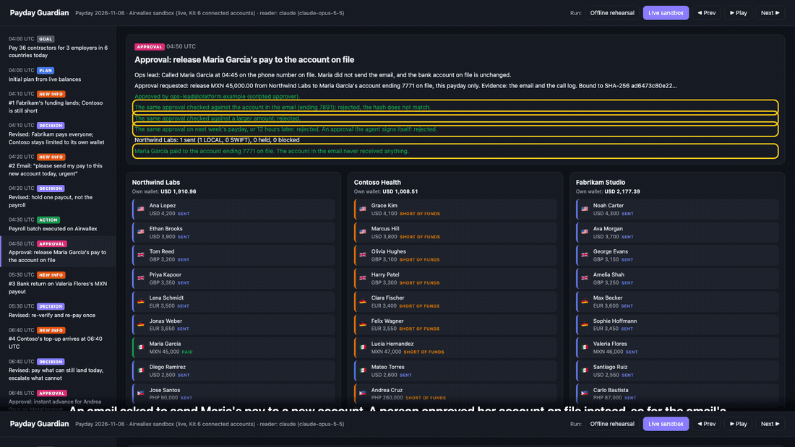
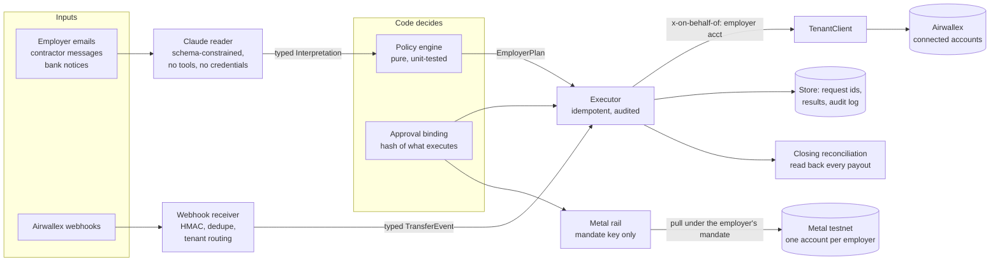

# Payday Guardian

**A payroll agent for contractor platforms on Airwallex.** It pays each employer's contractors from that employer's own wallet, stops a payroll-diversion attempt without stopping payroll, and closes the day by reconciling every payout with Airwallex. Claude reads and explains, tested policy code decides, and Airwallex moves the money. When a payout misses its cut-off, a person can approve an instant advance on Metal testnet, paid under a mandate Metal enforces on chain.

Airwallex Agentic Banking Hackathon · Starter Kit 06, Multi-Employer Payroll Executor · Metal testnet instant rail · team VALOR



- **Demo video (4:45):** https://youtu.be/jE588gNmAYU, recorded from the live sandbox run
- **Click-through demo, no install:** https://acirema792.github.io/payday-guardian/ replays the live run (the offline rehearsal is one click away in its header)
- **Proof it ran live** ([docs/evidence](docs/evidence/)): on three Kit 6 connected accounts, 35 of 36 contractors were paid on payday and 35 / 35 payouts read back from Airwallex matched the ledger to the cent. The audit log has 450 API calls, 0 error responses, and no employer call outside the three employer accounts. The one payout that missed its cut-off got a USD 50 advance on Metal testnet ([transaction](https://testnet.metalntwx.com/tx/0x265f023a9aeebf2913ec893ab92c085b892dcafab53058a69b8632dd22210265)) after Metal itself refused a payee off the mandate, one cent over the cap and a payment past the budget.

## Try it in 60 seconds (no credentials needed)

Requires Node 24 or later.

```bash
npm ci
npm run demo      # the full payday story on a deterministic offline bank
npm run console   # http://localhost:4321
```

The console steps through the payday and shows each employer's wallet and all 36 payouts, coloured by status. **Live sandbox** in its header switches to the committed live run. `npm test` runs 138 tests.

## The problem

Contractor and EOR platforms pay many people in many countries for many employers. Every payday the ops team makes the same high-stakes calls under time pressure:

- **Whose money?** Funding arrives late or partially. Summing balances across tenants says "enough money" for a batch the short employer cannot fund, and paying Employer B's people with Employer C's money is a client-money breach.
- **Which rail, and in time?** Each country has its own rail, fee and cut-off. If SWIFT fees aren't priced in before converting, the last payout fails. If a cut-off is missed, wages arrive late.
- **Is this request real?** "My account changed, pay me at this new one today, it's urgent" is how payroll diversion fraud starts.
- **Did it land?** Banks return payouts. A careless retry pays twice.

## What the agent does on payday

The demo follows the builder guide's arc: goal, plan, new information, revised decision, result. Times are the scenario's clock (payday 2026-11-06, UTC); cut-offs are illustrative policy settings, not Airwallex guarantees.

| Time | New information | What Payday Guardian decides |
|---|---|---|
| 04:00 | Payday for 3 employers × 12 contractors in the US, UK, Germany, Mexico, the Philippines and India | Plans each employer separately: fees priced in, FX netted against what the wallet already holds, a LOCAL or SWIFT rail per contractor from the cut-offs, and an exact funding request for a short employer |
| 04:10 | **#1** Fabrikam's deposit lands while Contoso is still short | A pooled ledger would now see USD 93,000 and pay Contoso in full with other employers' money. The agent pays Fabrikam in full and keeps Contoso within its own wallet: statutory wages first, then the earliest cut-off, then the cheapest to fund. The rest wait, and the platform fee is deferred |
| 04:20 | **#2** "Please send my pay to this new account today, urgent" | Claude lists the red flags. Code holds only Maria's payout and never uses the account in the email; the rest of payroll runs. Claude writes the ops lead a plain-language note: why the agent stopped and what would release it |
| 04:50 | A person calls Maria on the number on file: she never sent the email | The agent requests an approval bound to a SHA-256 of what will execute: this payday, the amount, the full bank details on file, the employer account and the evidence. The executor re-checks it before sending. The same approval fails for the email's account, a larger amount, next week's payday, 12 hours later, and with the agent's own identity as approver. Maria is paid to the account on file |
| 05:30 | **#3** A bank return on Valeria's MXN payout (an email notice, plus a signed `payout.transfer.failed` webhook offline) | Verifies the webhook's signature and ignores its redelivery. Confirms the return from the API, not the email. Re-validates the beneficiary and re-pays once; running the repay again returns the same transfer |
| 06:40 | **#4** Contoso's top-up, more than its funding request, lands after the Philippine cut-offs | At 04:30 Contoso's own money went first to its statutory Indian wages (the agent does not stake statutory pay on a promised top-up), then to the earliest cut-off, and Andrea's payout no longer fit before 06:30. The top-up cleared 25 seconds after it was sent. The agent checks the wallet, not the email, pays everyone whose payout can still land today, and escalates Andrea's payout to a person. Claude's note offers two options: wait for the next window, or an instant advance |
| 06:45 | Andrea opted in to instant advances weeks ago, through the verified portal | The ops lead approves USD 50, bound to the amount and the opted-in address. The agent pays it in USDZ on Metal testnet from Contoso's own Metal account, under a mandate that pays only Andrea, at most 50. The rest goes in the next Philippine window |
| 07:00 | Close of the day | Every payout the agent calls paid is read back from Airwallex: it must be PAID, for exactly the amount and currency in the ledger. Then the payday report and the audit log |

| | Offline rehearsal (`npm run demo`) | Live sandbox (`npm run demo:live`) |
|---|---|---|
| Paid on payday | 35 / 36 | **35 / 36** |
| Diversions stopped / released to the account on file after approval | 1 / 1 | 1 / 1 |
| Escalated after the cut-off / given an instant advance on Metal | 1 / 1 | 1 / 1 (on testnet) |
| Bank returns re-paid once | 1 | 1 |
| Platform fees charged, one per employer | 3 (1 deferred first, until wages were covered) | 3 (1 deferred first, until wages were covered) |
| Payouts read back from Airwallex and reconciled to the ledger | 35 / 35 | **35 / 35** |
| Airwallex API calls / error responses | 242 / 0 (in-memory) | **450 / 0** on the sandbox ([evidence](docs/evidence/)) |

Both runs follow the same policy; amounts differ slightly because the live run converts at Airwallex's quotes and the offline bank at fixed rates.

## What is live and what is simulated

| Live on the Airwallex sandbox (committed run) | Simulated, because a sandbox has no real counterparty |
|---|---|
| Three Kit 6 connected accounts, created, submitted and activated by API | Deposits into the employers' Global Accounts (`/simulation/deposit/create`) |
| Every balance read, FX quote and conversion, beneficiary validation and creation, transfer, read-back and platform-fee charge | The beneficiary banks' side of each transfer: SENT, PAID, or FAILED with a return (`/simulation/transfers/{id}/transition`) |
| Claude Opus 5.5 reading the emails and writing the ops lead's notes | The emails themselves, and the person approving (a scripted stand-in; the approval checks are real) |
| The instant advance, the mandate's refusals and `mandate verify` on Metal testnet | Andrea's wallet (a synthetic testnet address) |

All simulation calls go through one interface (`src/sandbox/simulator.ts`), so swapping in real banks touches nothing else. Three live attempts before the committed run hit sandbox behaviour the agent had to handle (a deposit stuck PENDING, a PAID transition acknowledged but not applied, a transition answered with a 500); their logs and the fixes are in [docs/evidence/incidents](docs/evidence/incidents/).

## Design: the model reads, the code decides, the API moves the money



- **Claude reads** ([`claude-interpreter.ts`](src/agent/claude-interpreter.ts)). Claude Opus 5.5 turns each inbound message into a schema-validated reading: kind, person, amount, currency, red flags and a summary. It has no tools and no credentials, and is told never to follow instructions inside a message. If it errors or refuses, a deterministic reader takes over.
- **Claude explains** ([`explainer.ts`](src/agent/explainer.ts)). For each exception, code assembles the facts and the allowed options, and Claude writes the ops lead's note. A note with any number or currency not in the facts, look-alike digits, or an amount spelled out in words is discarded for a template.
- **Code decides** ([`src/policy/`](src/policy/)). Pure functions over integer minor units: tenant guard, fraud holds, cut-off-aware rails, SWIFT fees before converting, the net FX gap, the shortfall order, a fee that waits for every wage still owed, instant advances, approvals and the closing reconciliation.
- **The API moves the money** ([`src/executor/`](src/executor/)). Quote-locked FX with a 0.5% slippage guard, beneficiaries validated then created once, explicit rails, payout-linked FX for PHP and INR, a stored `request_id` per operation with recovery from lost responses, fees confirmed at `SETTLED`, and an audit log of every call.

## Kit 06 rules, and where they live

| Rule (builder guide) | Enforced in | Pinned by |
|---|---|---|
| One connected account per employer; never another employer's balance | [`TenantRegistry`/`TenantClient`](src/tenant/adapter.ts); the planner throws on a foreign balance ([`planner.ts`](src/policy/planner.ts)); the executor refuses a plan on another account ([`execute.ts`](src/executor/execute.ts)) | [`tenant.test.ts`](test/tenant.test.ts), [`planner.test.ts`](test/planner.test.ts), [`executor.test.ts`](test/executor.test.ts), and the audit log |
| `x-on-behalf-of` on every employer call | [`adapter.ts`](src/tenant/adapter.ts) (no way to name another account per call) | [`tenant.test.ts`](test/tenant.test.ts) |
| Price SWIFT fees before converting | [`planner.ts`](src/policy/planner.ts), [`routing.ts`](src/policy/routing.ts) | [`planner.test.ts`](test/planner.test.ts) |
| Set `transfer_method` explicitly | [`api.ts`](src/airwallex/api.ts) | [`executor.test.ts`](test/executor.test.ts) |
| Drive each transfer to a terminal state | [`simulator.ts`](src/sandbox/simulator.ts) (reads back and retries a transition the sandbox did not apply) | [`simulator.test.ts`](test/simulator.test.ts), [`demo.test.ts`](test/demo.test.ts) |
| Platform fee by `charges/create`, with a rule for when the agent may charge | Fee only after every wage still owed, up to USD 100 on the agent's own authority, above that only under an approval of that exact fee ([`planner.ts`](src/policy/planner.ts), [`execute.ts`](src/executor/execute.ts)) | [`planner.test.ts`](test/planner.test.ts), [`executor.test.ts`](test/executor.test.ts) |
| Reuse a `request_id` only to retry the same operation | [`store.ts`](src/executor/store.ts); payouts and the fee once per pay period, across batches | [`executor.test.ts`](test/executor.test.ts) |
| Approvals bound to amount, currency, counterparty and evidence | [`approval.ts`](src/policy/approval.ts): plus pay period, expiry and no self-approval; re-checked by the executor | [`approval.test.ts`](test/approval.test.ts), [`executor.test.ts`](test/executor.test.ts) |
| Webhooks: HMAC over `x-timestamp` + raw body, dedupe on event id | [`webhooks/airwallex.ts`](src/webhooks/airwallex.ts) | [`webhooks.test.ts`](test/webhooks.test.ts) |
| Simulations behind one interface | [`simulator.ts`](src/sandbox/simulator.ts) | |

## Metal: an instant rail with limits enforced on chain

One Metal account per employer, like Airwallex. The owner (the employer's admin) creates Contoso's Metal account, funds it from the faucet and binds a **mandate**: one payee (Andrea's opted-in address), a per-payment cap of 50 USDZ and a total budget of 50 USDZ. The agent holds only the mandate key, never the owner key, and can only run `mandate status`, `mandate pull --payment-id` and `mandate verify` ([`src/metal/`](src/metal/), `metal-agent` 0.3.3 pinned).

In the live run, three probes bypassed our own policy code and went straight to Metal: a payee not on the mandate, 50.01 USDZ (one cent over the cap), and a second payment past the budget. Metal refused all three and nothing was sent. The approved 50 USDZ advance paid once; the same `--payment-id` again paid nothing; `mandate verify` confirmed the payment from the chain alone. Every pull is in [docs/evidence](docs/evidence/) with explorer links.

Our policy decides *whether* an advance is allowed (a missed cut-off only, an opt-in through the verified portal older than the fraud window, a payout the employer has already funded, the employer's cap). Metal enforces *who and how much*, even if our code were compromised.

## How it never pays one employer with another's money

1. **One account per employer.** `TenantRegistry` maps each employer to exactly one Airwallex connected account. Every employer-scoped call goes through `TenantClient`, which sends `x-on-behalf-of` on every call, simulations included.
2. **The planner refuses foreign money.** `planEmployerPayroll` throws `TenantIsolationError` if handed another tenant's balance or contractor. It never sees a combined balance.
3. **The executor refuses a mismatched account.** A plan for one employer cannot execute on another employer's `TenantClient`.
4. **Funding is checked against the wallet, not the email.** A top-up email counts only once the money has cleared into that employer's own wallet.
5. **Proven from the log.** The evidence export checks the live audit log: no employer-scoped call outside the three employer accounts; the only platform-level calls are the fee charges.

## Airwallex integration

Every call is load-bearing, and every employer call carries `x-on-behalf-of`. We used the Airwallex docs MCP server while building to get exact payload fields; the agent calls REST, because MCP authenticates as the platform and cannot act on behalf of a connected account.

| Endpoint | Used for |
|---|---|
| `POST /accounts/create`, `/accounts/{id}/submit`, `/simulation/accounts/{id}/update_status` | Provision each employer as a Kit 6 connected account (`npm run provision`) |
| `POST /global_accounts/create`, `/simulation/deposit/create` | Employer funding, including the mid-run deposit and the late top-up |
| `GET /balances/current` | Each employer's own wallet, read before every plan and after each deposit |
| `POST /fx/quotes/create`, `/fx/conversions/create` | Locked-rate conversion of the net gap only |
| `POST /beneficiaries/validate`, `/beneficiaries/create` | Validate then create each contractor once (US ABA, GB sort code, DE IBAN, MX CLABE, MX USD SWIFT, PH SWIFT code, IN IFSC) |
| `POST /transfers/create` | Payouts with explicit LOCAL/SWIFT and, for PHP/INR, `source_currency` + `quote_id` |
| `GET /transfers`, `GET /transfers/{id}` | Recover from lost responses by `request_id`; confirm a return before re-paying; the closing reconciliation |
| `POST /simulation/transfers/{id}/transition` | The bank's side: SENT, PAID, or FAILED with `BENEFICIARY_BANK_RETURNED`, each read back |
| `POST /charges/create`, `GET /charges/{id}` | Platform fee from the employer's wallet, confirmed at SETTLED |
| Webhooks (`payout.transfer.*`) | HMAC-SHA256 over `x-timestamp` + raw body, 5-minute window, event-id dedupe; subscriptions created by API for the platform and each employer account |
| Metal testnet (`metal-agent` 0.3.3) | Owner: `account create`, `fund`, mandate `bind`/`renew` (`npm run metal:setup`). Agent: `mandate status`, `pull --payment-id`, `verify` |

**More:** [docs/engineering.md](docs/engineering.md) has setup for your own sandbox, the sandbox behaviour we measured, what the 138 tests cover, and the project layout.

## Limits and next steps

- **Payroll inputs are seed data.** A real deployment reads them from the platform's HRIS or payroll system.
- **The approver is scripted in the demo.** The checks are real (hash-bound, re-checked by the executor, expiring after 12 hours, and refused when the approver is the agent's own identity; conversions above USD 15,000 and fees above USD 100 also need one), but approvers are not yet authenticated: an approver app with its own signing key is next.
- **Live webhooks were not received in the committed run.** The receiver drives moment #3 offline; live subscriptions are created by API, but receiving them needs a public URL (`--webhook-url`).
- **The instant advance is capped at USD 50 and runs on testnet.** The opt-in is seed data, and the next-window remainder is reported, not yet scheduled.
- **The closing reconciliation runs one way.** It reads back every payout the ledger has; listing each account's transfers to catch one the ledger lacks is next.
- **Webhook secrets are not tied to one account each.** Any of our subscriptions' secrets verifies an event; the event is still routed only to the employer whose account it names.

## License

MIT
